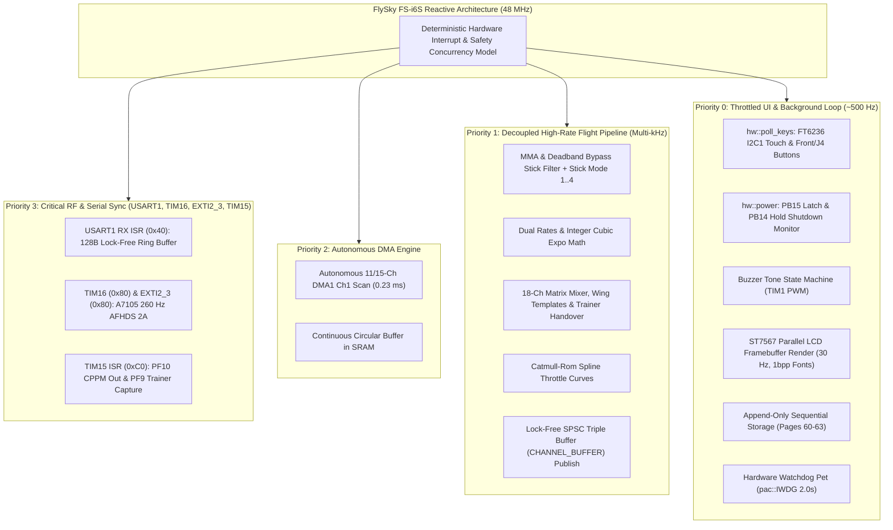

# flysky-i6s-rs

A minimalist, clean-slate RC transmitter firmware for the **FlySky FS-i6S**, written in `no_std` Rust.

Powered by the unified **`ferrox`** flight-control core and a dedicated FS-i6S Hardware Abstraction Layer (`src/hw/`), supporting the built-in **A7105** 2.4 GHz RF transceiver (**AFHDS 2A** protocol), external **CRSF / ExpressLRS** modules, **FT6236 Capacitive Touchscreen**, **Electronic Power Management**, **TIM15 Trainer Subsystem (PPM Out & In)**, and **128×64 LCD** interface.

---

## 1. Overview & Philosophy

The FlySky FS-i6S features an industrial design with an integrated capacitive touchscreen, electronic power latching, dual front/rear tactile buttons, self-centering or friction gimbals, and rich internal expansion headers (`J15`, `H1`, `J4`, `PC1..PC4`).

`flysky-i6s-rs` provides a clean-slate firmware written in bare-metal `no_std` Rust designed with:
- **Unified `ferrox` Core & Zero Dead-Code HAL (`src/hw/`):** Shares a 100% byte-for-byte identical hardware-agnostic flight, mixer, storage, UI, RF, CRSF, trainer, and USB core with [`flysky-i6x-rs`](https://github.com/bryansouza/flysky-i6x-rs), while isolating all FS-i6S board peripherals inside [`src/hw/`](src/hw/).
- **Zero-Heap, Deterministic Memory:** Fully static allocation with bare-metal `no_std` and in-tree 1bpp bitmap fonts (`src/display/fonts.rs`), eliminating dynamic allocation overhead, allocator stalls, and heap fragmentation.
- **Lock-Free Concurrency & Watchdog Recovery:** Deterministic priority-driven interrupt scheduling (`TIM16` 260 Hz packet sync, `EXTI2` RF ready, `USART1` CRSF RX, `TIM15` PPM In/Out) paired with lock-free atomic triple-buffering (`CHANNEL_BUFFER`). 2.0s independent hardware watchdog (`pac::IWDG`) with LSI clock isolation, debug halt freezing, bounded sync, and <2 ms in-flight warm reset recovery that bypasses startup interlocks to prevent lockouts.
- **Hardware Integration for FS-i6S:**
  - **Electronic Power Latching (`PB15` / `PB14` / `PD10` / `PD11`):** Instant power rail lock at boot, soft-power hold detection (>= 1.5s) with safe Flash flush, and dual blue power button LED indication.
  - **FocalTech FT6236 Capacitive Touchscreen (`PB8` / `PB9` / `PA15` / `PC12`):** Hardware I2C1 Fast Mode driver @ 400 kHz, gesture decoding (Swipe Up/Down/Left/Right), direct tap zones, and virtual dashboard trims.
  - **Front/Rear Tactile Buttons (`PA9` / `PA10`):** Direct hardware buttons for Cancel/Back (`PA9`) and OK/Select (`PA10`), configurable in flight mode as RC switches (`SWE`/`SWF`), Timer Reset, 3-Axis Instant Trim, or Stick Trim Modifiers.
  - **Zero-Disassembly DFU Bootloader:** Cold boot combo (hold Front Buttons `PA9` + `PA10`), System Info menu reboot option (`[OK] Reboot DFU`), and USB CDC serial command (`dfu`).
- **Full 18-Channel Flight Engine:** Dedicated support for built-in A7105 AFHDS 2A (18-channel interleaved i-BUS/S.BUS encoding + configurable TX power), external CRSF/ELRS modules (up to 1.875M baud, full/half-duplex), 20-model sequential storage, 18-channel freeform matrix mixer, universal ADC input modes (`2-POS`, `3-POS`, `6-POS`, `POT`, `POT-D`, `INST-TRIM`), and configurable 4-tile telemetry dashboard.
- **Lightweight Footprint:** **~113.6 KB Binary** (`.text` 108,248B + `.data` 8,060B = 116,308B out of 120 KB flash partition, leaving ~6.4 KB headroom) and **~8.9 KB static RAM** (`.data` 8,060B + `.bss` 1,056B = 9,116B out of 16 KB SRAM, leaving >7.0 KB stack safety margin).

---

## 2. Target Hardware Map (STM32F072VB / APM32F072VB)

| Peripheral | Controller / Spec | MCU Pins & Ports | Notes |
| :--- | :--- | :--- | :--- |
| **MCU** | STM32F072VB / APM32F072VB (Cortex-M0 @ 48 MHz) | ARMv6-M (`thumbv6m-none-eabi`) | 128 KB Flash (120 KB code + 8 KB storage), 16 KB SRAM |
| **Power Latch** | Electronic Power Switch | `PB15` (Output) | Driven HIGH immediately on boot in `hw::power::init()`; held HIGH across DFU jump |
| **Power Button**| Soft Power Shutdown Sense | `PB14` (Input, Active Low) | Monitored by `PowerManager`; hold >= 1.5s triggers safe Flash flush & shutdown |
| **Power LEDs** | Dual Blue Button LEDs | `PD10`, `PD11` (Outputs) | Solid ON in flight mode; 2 Hz blink when Settings Menu is open |
| **Touchscreen** | **FocalTech FT6236** Capacitive | **I2C1** + GPIOs | 400 kHz Fast Mode, 7-byte packet reader, 90° coordinate swap to 128x64 |
| | I2C SCL / SDA | `PB8` (SCL) / `PB9` (SDA) | Hardware I2C1 (AF1) |
| | Hardware Reset (RST) | `PA15` (Active Low) | 5 ms hardware reset pulse on initialization |
| | Touch Interrupt (INT) | `PC12` (Active Low) | Signals available touch packets; polled at single-cycle speed |
| **Front Buttons** | Dual Tactile Switches (Power assembly) | `PA9` (Left) / `PA10` (Right) | Active LOW with pull-ups; configurable as `SWE`/`SWF`, `TIMER RESET`, `INSTANT TRIM`, or `TRIMS MOD` |
| **DFU Bootloader**| STM32 ROM DFU Bootloader | `0x1FFF_C800` | Cold combo: hold `PA9` + `PA10` at power-on; soft DFU via `SYSTEM INFO` or USB CLI `dfu` (`0x2000_3FF0`) |
| **Watchdog** | Hardware Independent Watchdog | `pac::IWDG` (40 kHz LSI) | 2.0s hard timeout, `DBGMCU_APB1_FZ` halt freeze, sub-2ms in-flight warm recovery (`RCC_CSR`) |
| **RF Transceiver** | Amiccom **A7105** 2.4 GHz | **SPI1** + GPIOs | SPI1 (`PE13` SCK, `PE14` MISO, `PE15` MOSI); auto deep-sleep (`0x0F`) in CRSF mode |
| | Chip Select (CSN) | `PE12` (Active Low) | Fast GPIO output |
| | PA / LNA / Antenna Switch | `PE8` (RX), `PE9` (TX), `PE10`/`PE11` | Diversity TR switch; configurable output power (`100mW`, `10mW`, `1mW`, `100uW`) |
| | Packet Ready IRQ | `PB2` (EXTI2) | GIO2 line from A7105 (Tx/Rx done) |
| | RF Timer | `TIM16` | Periodic packet scheduling (3.850 ms / 259.74 Hz) |
| **Display** | **ST7567** (128×64 Monochrome LCD) | 8-bit 6800 Parallel Bus | 1024-byte framebuffer in RAM; 30 Hz refresh (~33 ms); Electronic Volume (EV) contrast (20..50) |
| | Data Bus (D0..D7) | `PE0 .. PE7` | Full-byte ODR write (`GPIOE->ODR[7:0]`) |
| | Control Lines | `PB3` (RS), `PB4` (RST), `PB5` (RW), `PD2` (CS), `PD7` (E) | 6800-series parallel bus |
| | Backlight | `PF3` / `PC9` | Active HIGH (`PF3`) / Hardware PWM (`PC9` `TIM3_CH4`) |
| **Analog Inputs** | 12-bit ADC1 via DMA | 11 or 15 Channels scanned | Continuous circular DMA1 Ch1 buffer (`0x07FF` stock, `0x7FFF` with `Ext ADC (PC)`) |
| | Sticks (RH, RV, LV, LH) | `PA0`, `PA1`, `PA2`, `PA3` | Channels 0..3 (mapped dynamically via Stick Mode 1..4) |
| | Potentiometers (VRA, VRB)| `PA6`, `PA7` | Channels 6 (VR1 / Left), 7 (VR2 / Right) |
| | Switches (SA, SB, SC, SD)| `PA4`, `PA5`, `PB0`, `PB1` | Channels 4 (2-pos), 5 (3-pos), 8 (3-pos), 9 (2-pos); configurable via `AdcInputMode` |
| | Battery Sense | `PC0` | Channel 10 ($10\text{ k}\Omega / 5.1\text{ k}\Omega$ divider: `(raw * 977064) / 409500` mV) |
| | Extended Analog (`Ext ADC`)| `PC1`, `PC2`, `PC3`, `PC4` | Channels 11..14 (`ADC_IN11..14`): `VRC..VRF` pots or `SWI..SWL` switches |
| **CRSF / Serial** | External Module Bay (`J15` & `H1`) | `USART1` (`PB6` TX / `PB7` RX) | 115.2k, 416.6k, 420k, 921.6k, 1.875M baud; full (2W) & half-duplex (1W); `PF6` (`H1`) power control |
| **Trainer Port** | Hardware `TIM15` CPPM In/Out | `PF10` (`TIM15_CH2` Out) / `PF9` (`TIM15_CH1` In) | 22.5 ms 8-CH CPPM output on `PF10`; 0.5 µs input capture on `PF9` with `SD` Down handover |
| **SWD / Buttons** | Header `J4` | `PA13` (SWDIO / `SG`), `PA14` (SWCLK / `SH`) | Switchable in `Radio Setup -> J4 Mode` between ARM SWD Debug and `SG`/`SH` buttons |
| **USB Controller** | Native USB Full-Speed (12 Mbps)| `PA11` (D-) / `PA12` (D+) | Joystick HID (100 Hz), CDC-ACM Serial (CLI + JSON stream), Composite, Off |
| **Audio** | Piezo Buzzer | `TIM1_CH1` (`PA8`) | Hardware PWM frequency & non-blocking tone sequencer (`Rich` & `Simple` profiles) |

---

## 3. Software Architecture



### Unified `ferrox` Crate & Hardware Abstraction (`src/hw/`)
The firmware is structured as a unified library crate (`ferrox` in [`src/lib.rs`](src/lib.rs)) paired with a thin board-specific hardware layer in [`src/hw/`](src/hw/):
- **Shared Core (`src/*`)**: 100% identical across `flysky-i6s-rs` and `flysky-i6x-rs` (`main.rs`, `lib.rs`, `chip/`, `display/`, `rf/`, `crsf/`, `trainer/`, `usb/`, `ui/`, `input.rs`, `mixer.rs`, `storage.rs`, `safety.rs`, `calib.rs`, `curve.rs`, `trim.rs`, `buzzer.rs`, `watchdog.rs`, `time.rs`).
- **FS-i6S Hardware Layer (`src/hw/`)**:
  - [`src/hw/mod.rs`](src/hw/mod.rs): Board constants, battery scaling, setup menu hooks, dashboard switch/pot rendering, and `BoardIdleState`.
  - [`src/hw/power.rs`](src/hw/power.rs): `PB15` electronic power latch, `PB14` hold-to-shutdown manager, and `PD10`/`PD11` blue LEDs.
  - [`src/hw/touch/`](src/hw/touch/mod.rs): FocalTech FT6236 I2C1 driver (`ft6236.rs`) and touch gesture / virtual trim / stick modifier navigator (`nav.rs`).
  - [`src/hw/adc.rs`](src/hw/adc.rs): 11/15-channel ADC1 + DMA1 circular scanner (`PA0..PA7`, `PB0..PB1`, `PC0`, and `PC1..PC4`).
  - [`src/hw/keys.rs`](src/hw/keys.rs): Front tactile buttons (`PA9`/`PA10`), J4 SWD buttons (`PA13`/`PA14`), and DFU entry checks.
  - [`src/hw/uart.rs`](src/hw/uart.rs): `USART1` (`PB6`/`PB7` on `J15`) CRSF driver and `PF6` (`H1`) external module power control.

---

## 4. AFHDS 2A, CRSF, & Trainer Subsystems

### Internal RF: AFHDS 2A & 18-Channel i-BUS
- **Frequency Hopping (FHSS):** Hops across 16 deterministic channels every 3.850 ms (259.74 Hz) seeded from the 96-bit silicon UID (`0x1FFFF7AC`).
- **18-Channel Encoding:** Packs channels 1..14 into the base 16-bit slots and interleaves channels 15..18 into the upper bits matching Betaflight/INAV `rx/ibus.c`.
- **Per-Model Receiver Settings:** Configurable RF transmit power (`100mW`, `10mW`, `1mW`, `100uW`), PWM servo refresh rate (`50..400 Hz`), output format (`PWM`/`PPM`), and serial protocol (`i-BUS`/`S.BUS`).

### External RF: CRSF / ExpressLRS (`USART1` on `J15`)
- **Multi-Speed Serial:** Supports `115.2k (Low)`, `416.6k (TBS)`, `420k (ELRS)` (default), `921.6k (Fast)`, and `1.875M (Max)` in both 2-wire Full-Duplex (`PB6` TX + `PB7` RX) and 1-wire Half-Duplex (`PB6` `HDSEL` with self-echo suppression).
- **A7105 Auto Deep-Sleep:** Automatically places the internal A7105 transceiver into deep sleep (`0x0F`) when CRSF mode is active.
- **Native On-Radio Configurator:** Zero-heap TBS-Agent style configurator supporting 16-device discovery, Parameter 0 root-folder fast loading, 6-level nested folders, selection/integer modal editing, and command execution.

### Trainer Port: Hardware `TIM15` CPPM Out & In (`PF10` / `PF9`)
- **PPM Output (`PF10` / `TIM15_CH2`):** Deterministic 22.5 ms 8-channel CPPM stream (300 µs negative sync pulse) for external multi-protocol modules and flight simulator dongles. Automatically paused during USB Joystick simulator mode.
- **Trainer Input (`PF9` / `TIM15_CH1`):** 0.5 µs resolution hardware input capture for wired buddy-box student radios and FPV head-trackers. Activated when `Trainer In` is enabled and switch `SD` is Down, with automatic instructor stick-override takeover (`> 5%` stick deflection) and 50 ms signal-loss failsafe recovery.

---

## 5. Display & User Interface (128×64)

The ST7567 parallel LCD driver maintains a **1024-byte framebuffer** in SRAM (`128 * 64 / 8`) rendered via in-tree 1bpp glyph bitmap tables (`FONT_4X6_DATA` and `FONT_6X10_DATA` in [`src/display/fonts.rs`](src/display/fonts.rs)).
- **Throttled Refresh Rate (30 Hz):** Decouples graphical drawing from the multi-kHz flight control loop.
- **Multi-Page Flight Dashboard:** 5 switchable screens cycled by swiping UP/DOWN or tapping `[UP]`/`[DOWN]`:
  1. **Page 1/5 (Gimbals, Switches & Pots):** Live stick sliders (adapted to Stick Mode 1..4), trim ticks, adaptive non-overlapping switch/pot bar (`SA..SH`, `SWI..SWL`, and `VRA..VRF` pots), and live flight timer.
  2. **Page 2/5 (Primary Channels 1..10):** Real-time graphic bars and microsecond pulse readouts (`988..2012 µs`).
  3. **Page 3/5 (Auxiliary Channels 11..18):** Real-time graphic bars and microsecond readouts for channels 11..18.
  4. **Page 4/5 (Model Dashboard / CRSF Link Status):** Model name, 12x12 model icon, RxID, curve summary, and live link stats.
  5. **Page 5/5 (Configurable 4-Tile Telemetry Dashboard):** 2×2 quadrant layout (`Top-L`, `Top-R`, `Btm-L`, `Btm-R`) configurable in `Radio Setup -> Telem Page` across 13 telemetry sensors (`RX BAT`, `LQ/RSSI`, `TX BAT`, `CURRENT`, `CAP mAh`, `TX PWR`, `SNR`, `PKT RATE`, `ANTENNA`, `PKTS TX`, `PKTS RX`, `TIMER`, `OFF`).

---

## 6. Project Documentation

Comprehensive technical documentation is maintained in the [`docs/`](docs/) directory:

- **[User Guide & Operations Manual](docs/USER_GUIDE.md)**: Complete operator guide covering touch/button controls, 5-page flight dashboard, all 13 settings submenus, flight timers, trainer port, calibration, and DFU flashing.
- **[System Architecture & Timing Model](docs/ARCHITECTURE.md)**: Unified `ferrox` core + `src/hw/` HAL design, 48 MHz clock tree, real-time concurrency model, watchdog recovery, and memory footprint.
- **[Implementation Roadmap & Phase Status](docs/ROADMAP.md)**: Phased development history from board bring-up through codebase unification.
- **[AFHDS 2A Protocol & A7105 RF Driver](docs/RF_PROTOCOL.md)**: SPI1 hardware driver, 16-channel FHSS hopping table, 18-channel interleaved i-BUS packet structure, Model Match, and receiver binding.
- **[Flight Inputs & Digital Trims](docs/INPUT_SUBSYSTEM.md)**: 11/15-channel ADC DMA scanner, universal `AdcInputMode` decoding, MMA jitter filtering, touch/modifier digital trims, and TIM1 PWM buzzer driver.
- **[Flight Control & 18-Channel Mixing](docs/MIXER.md)**: 4-stage pipeline, integer cubic expo, Elevon/V-Tail/Flaperon templates, auxiliary channel mapping (`CH5..CH18`), and EdgeTX freeform matrix mixing.
- **[Stick Calibration & Flash Persistence](docs/CALIBRATION_AND_STORAGE.md)**: Adaptive 2-step calibration wizard, tolerance margins, 140-byte `RadioConfig` / 128-byte `ModelConfig` layout, and 4-page append-only sequential storage.
- **[USB Subsystem & Simulator Manual](docs/USB_SUBSYSTEM.md)**: Hardware Full-Speed USB driver, 100 Hz HID Gamepad descriptor (8 axes, 16 buttons), CDC-ACM telemetry/CLI, and silent RF standby.
- **[CRSF / ExpressLRS Subsystem Guide](docs/CRSF_ELRS_GUIDE.md)**: Native CRSF/ELRS driver on `USART1` (`PB6`/`PB7` on `J15`), `PF6` (`H1`) power control, 5 baud rates up to 1.875M, and on-radio configurator.
- **[CRSF Protocol Specification & Verification](docs/CRSF_PROTOCOL_SPEC.md)**: Byte-level wire format, CRC8-DVB calculation, parameter discovery handshake, state machine lifecycle, and manual verification guide.
- **[Testing Methodology & Verification Guide](docs/TESTING.md)**: Dual-target host test harness (`140` unit tests), peripheral mocking, deterministic virtual time, and adversarial state machine verification.
- **[Ecosystem Context & Background](docs/FIRMWARE_COMPARISON.md)**: Background on open-source FlySky firmware development, OpenI6X heritage, FS-i6S hardware evolution, and the unified `ferrox` Rust architecture.
- **[Hardware Reference & Pinout](docs/HARDWARE_REFERENCE.md)**: Detailed schematics, pin mappings, power latch, FT6236 touch protocol, ST7567 LCD timings, `J15`/`H1`/`J4`/`PC1..PC4` headers, and dual-MCU profiles.

---

## 7. Current Firmware Footprint

- **Application Flash ROM**: **~113.6 KB** (`.text` 108,248B + `.data` 8,060B = 116,308 bytes) used out of **120 KB** partition (**~6.4 KB / 5.4% free headroom**).
- **Static RAM**: **~8.9 KB** (`.data` 8,060B + `.bss` 1,056B = 9,116 bytes) out of **16 KB** available (**>44% SRAM free** with **>7.0 KB** guaranteed stack safety margin).
- **Non-Volatile Storage**: **8,192 bytes** (Pages 60–63) managed as an append-only log (`RadioConfig` 140B + 20 × `ModelConfig` 128B = 2,700B active dataset) with automatic wear levelling.
- **Automated Host Test Suite**: **140 passing unit tests** (`cargo test-host`).

For the complete phase-by-phase feature checklist, see **[docs/ROADMAP.md](docs/ROADMAP.md)**.

---

## 8. Controls & Shortcuts

| Action | Control | Notes |
| :--- | :--- | :--- |
| **Power On** | **Power Buttons** | Press & hold power buttons until blue LEDs illuminate and welcome screen appears |
| **Power Off** | **Hold Power Button (>= 1.5s)**| Displays animated shutdown modal; safely flushes Flash and cuts power rail via `PB15` |
| **Cycle Flight Pages** | **Swipe UP / DOWN or Edge Tap** | Cycles through Page 1/5 (Gimbals), Page 2/5 (CH 1..10), Page 3/5 (CH 11..18), Page 4/5 (Model), Page 5/5 (Custom Telem) |
| **Open Settings Menu** | **Center Tap on Screen or Hold OK (`PA10`)** | Opens 13 submenus: Model Select, Model Setup, D/R & Expo, Thr Curve, Wing/Mixer, Aux Channels, Ch Reverse, Radio Setup, Protocol Setup, Monitors, Calib, Diag, & Info |
| **Menu Navigation** | **Swipe / Tap Zones / Front Buttons** | Top = Up, Bottom = Down, Left = Cancel, Right = OK; Left Rear (`PA9`) = Cancel, Right Rear (`PA10`) = OK |
| **Digital Trims: Stick Modifier** | **Rear Buttons + Gimbal Deflection** | When `Rear L` / `Rear R` set to `TRIMS MOD`: Hold `PA9` + Left Stick or `PA10` + Right Stick |
| **Digital Trims: Virtual Touch** | **Perimeter Tap Targets** | Left border = Throttle trim, Right border = Pitch trim, Bottom border = Yaw/Roll trims |
| **3-Axis Instant Trim** | **Rear Right (`PA10`) or `INST-TRIM` Switch** | Captures current Aileron, Elevator, and Rudder stick offsets into model trims (or resets to 0 at neutral) |
| **Enter DFU Bootloader (Cold Boot)**| **Hold Rear Buttons (`PA9` + `PA10`)** | Zero-disassembly cold-boot combo at power-on to jump directly into factory ROM DFU |
| **Enter DFU Bootloader (Software)** | **`SYSTEM INFO` Menu or USB CLI** | `System Info -> [OK] Reboot DFU` or USB serial command `dfu` / `reboot bootloader` |
| **Reset Flight Timer** | **Hold `[CANCEL]` (>= 1.0s) or Rear L** | Displays centered HUD progress bar on flight screen (or instant click when `Rear L` = `TIMER RESET`) |
| **Direct Calibration (Boot)**| **Hold `OK` (`PA10`) during Power-On** | Launches adaptive 2-step calibration wizard immediately on boot |

---

## 9. Flashing, Full Flash Backup, & Reversion

The stock FlySky FS-i6S features an on-board Micro-USB port wired directly to the STM32F072 microcontroller. Flashing requires **zero disassembly**:

### Step 1: Enter Factory ROM DFU Mode

You can enter DFU mode using any of three convenient methods:

#### A. Zero-Disassembly Cold-Boot Combo (Recommended)
1. Ensure the transmitter is powered **OFF**.
2. Press and hold both rear/front tactile push-buttons simultaneously (**Left Button `PA9` + Right Button `PA10`**).
3. While holding both buttons, press the power buttons to turn the unit on. `PB15` latches power ON, and the MCU jumps straight into the permanent STM32 factory ROM DFU bootloader (`0483:df11` for STM32, `314b:0106` for APM32).

#### B. Software Menu Trigger
From the running firmware, navigate to **`Settings -> 13. System Info`**, and tap/press **`[OK]`** (`[OK] Reboot DFU`). The firmware writes `0xDEADBEEF` to SRAM `0x2000_3FF0`, maintains power on `PB15`, and warm-reboots directly into ROM DFU.

#### C. USB Serial CLI Command
When connected via USB CDC serial (`SERIAL` or `COMPOSITE` mode), simply send `dfu` or `reboot bootloader` in the terminal.

### Step 2: Backup Entire Flash Memory (Recommended Before First Flash)
Before flashing custom firmware, pull your complete 128 KB on-chip Flash memory (including stock firmware, factory calibration, and existing model data) directly to a file:
```bash
# Pull complete 128 KB on-chip Flash to a local backup file:
dfu-util -a 0 -s 0x08000000:131072 -U stock_backup.bin
```

### Step 3: Flash flysky-i6s-rs
Flash the compiled release binary via USB DFU:
```bash
# Flash release binary (STM32F072):
dfu-util -a 0 -s 0x08000000:leave -D flysky-i6s.bin

# For APM32F072 silicon:
dfu-util -a 0 -d 314b:0106 -s 0x08000000:leave -D flysky-i6s.bin
```

> [!TIP]
> **DFU Error State (`DFU state(10) = dfuERROR`)?**
> If `dfu-util` reports `Device's firmware is corrupt. It cannot return to run-time operations`, run `dfu-util -a 0 -e` to send a `DFU_CLRSTATUS` reset. Always include `:leave` on `-s 0x08000000:leave` so the bootloader exits cleanly.

### Step 4: Revert to Stock Anytime
Because the hardware DFU bootloader is stored in permanent, read-only system ROM by STMicroelectronics, the transmitter is **unbrickable**. You can restore your full flash backup at any time:
```bash
dfu-util -a 0 -s 0x08000000:leave -D stock_backup.bin
```

---

## 10. Development Methodology, Automated Testing, & AI Assistance

This project was built through a **human-directed, AI-assisted development workflow** with physical hardware bench testing and automated host verification.

### Automated Testing & Dual-Target Harness
To guarantee mathematical correctness and protocol compliance without requiring a physical radio or slow hardware emulators, `flysky-i6s-rs` features a **zero-file-move dual-target test harness** via the unified `ferrox` library crate:
- **Host Unit Test Execution**: Running `cargo test-host` compiles `ferrox` against the host target (`x86_64`) with standard library support, executing **140 unit and adversarial regression tests** across flight curves, digital trims, touchscreen gesture decoding, matrix mixers, trainer PPM handover, and CRSF/ELRS state machines in **sub-second time**.
- **Peripheral & Timing Decoupling**: Peripheral drivers in `src/hw/` and `src/trainer/` use `#[cfg(test)]` mocks to simulate serial UART FIFO queues, touch coordinates, and advance virtual time deterministically.
- **Physical Hardware Validation**: Every subsystem (DMA ADC scanning, FT6236 capacitive touchscreen, electronic power latch, A7105 SPI/RF state machine, ST7567 parallel bus LCD, USB HID/CDC descriptors, `USART1` CRSF/ELRS engine, `TIM15` PPM In/Out, and Flash storage) has been verified on hardware.

For detailed test architecture, adversarial verification scenarios, and developer commands, refer to the **[Testing Methodology & Verification Guide](docs/TESTING.md)**.

---

## 11. Acknowledgments & Prior Art

This project stands on the shoulders of the open-source RC community and owes special gratitude to:

- **Kuba (qba667), Janek (ajjjjjjjj), and the OpenI6X Team**: For their groundbreaking reverse-engineering of the FlySky FS-i6X/i6S hardware, bus timings, ST7567 LCD initialization sequence, A7105 SPI registers, bootloader jump sequences, and the `PC9` backlight PWM dimming mod.
- **Wimalopaan**: For extensive real-hardware testing on both FS-i6X and FS-i6S, logic analyzer protocol traces, multi-pot/switch hardware expansion verification, and deep feedback on TBS-Agent UI paradigms and over-the-air CRSF parameter synchronization.
- **OpenTX and EdgeTX Teams**: For defining modern open-source RC transmitter mixing, telemetry architectures, and simulator standards.
- **ExpressLRS & Team BlackSheep**: For pioneering open, high-performance CRSF protocols and parameter synchronization.

---

## 12. License & Disclaimer of Liability

This project is open-source software provided under the **GNU General Public License v3.0 (GPL-3.0)**.

### Disclaimer of Warranty
THE SOFTWARE IS PROVIDED "AS IS", WITHOUT WARRANTY OF ANY KIND, EXPRESS OR IMPLIED, INCLUDING BUT NOT LIMITED TO THE WARRANTIES OF MERCHANTABILITY, FITNESS FOR A PARTICULAR PURPOSE, TITLE, AND NONINFRINGEMENT. IN NO EVENT SHALL THE AUTHORS, MAINTAINERS, OR COPYRIGHT HOLDERS BE LIABLE FOR ANY CLAIM, DAMAGES, OR OTHER LIABILITY, WHETHER IN AN ACTION OF CONTRACT, TORT, OR OTHERWISE, ARISING FROM, OUT OF, OR IN CONNECTION WITH THE SOFTWARE OR THE USE OR OTHER DEALINGS IN THE SOFTWARE.

### Operational Safety Warning
Operating radio-controlled aircraft, multirotors, and vehicles involves inherent risks of personal injury, property damage, and loss of life. Flashing custom or experimental firmware is done entirely at your own risk.

Pilots are solely responsible for:
1. Conducting comprehensive ground bench tests and fail-safe verification (e.g., motor shutoff on radio power loss) prior to flight.
2. Performing physical range checks in accordance with local model aviation safety guidelines.
3. Complying with all local radio frequency regulations, transmission power limits, and model aviation safety codes.
