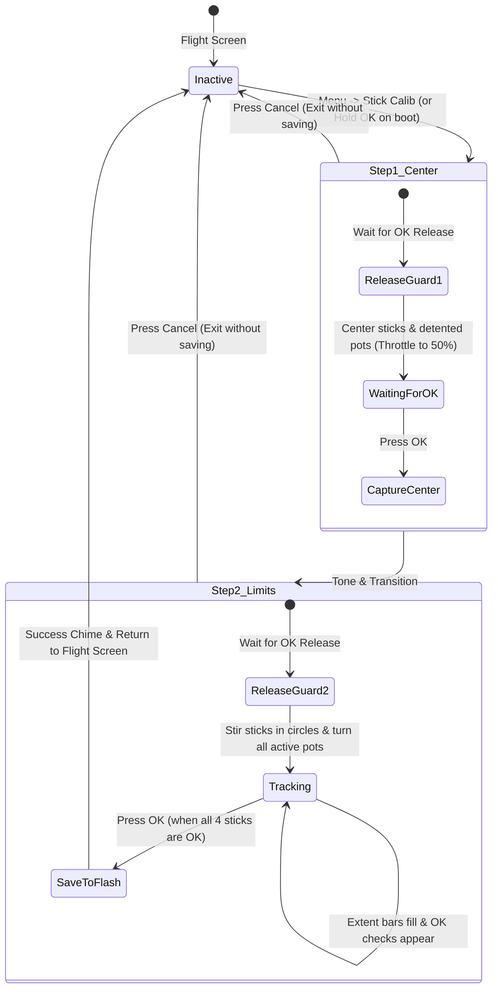

# STICK CALIBRATION & FLASH PERSISTENCE

Technical documentation for the interactive adaptive 2-step calibration wizard and the non-volatile Flash configuration storage on the FlySky FS-i6S.

---

## 1. Flash Storage Layout (`src/storage.rs`)

Configuration and model memories are stored in an 8 KB append-only log across the final four 2 KB sectors of the microcontroller's 128 KB internal Flash:
- **Flash Storage Range:** `0x0801_E000 .. 0x0802_0000` (Pages 60, 61, 62, & 63 of STM32F072VB / APM32F072VB).
- **Total Sector Size:** 8,192 bytes (4 × 2048-byte pages).
- **Storage Engine:** Log-structured append-only Key-Value map powered by the `sequential-storage` crate (`sequential_storage::map`).
- **Key-Value Mapping:**
  - **Key `0`:** Global radio configuration (`RadioConfig`, **140 bytes**, 4-byte aligned).
  - **Keys `1..=20`:** Model memory slots 1 through 20 (`ModelConfig`, **128 bytes** each).
- **Append-Only Write Performance:**
  - Incremental updates write only ~132–144 bytes to the active flash log page in **~2.8 ms** (measured on hardware).
  - **Zero page erases** during routine operation: editing trims, curves, or model settings causes zero perceptible UI stutter or audio glitch.
  - **In-Flight Write Protection:** Flash writes are strictly inhibited while the aircraft is armed (`!pipeline.prev_armed`), preventing bus contention during flight.
  - **Automatic Wear-Levelled Compaction:** When all 4 pages become full of historical revisions, `sequential-storage` automatically compacts current active records into a newly erased page, rotating evenly across Pages 60–63.
  - **Watchdog Protection:** During multi-page compaction routines, the hardware watchdog (`pac::IWDG`) is explicitly fed between page erase cycles, preventing 2.0s resets.

### Storage Structures (`RadioStorage` v5)

All storage structures are compiled with strict C-compatible alignment (`#[repr(C)]`) and compile-time size assertions (`core::mem::size_of`):

```rust
pub const FLASH_MAGIC: u32 = 0x4653_4B59; // "FSKY"
pub const CONFIG_VERSION: u32 = 5;
pub const NUM_MODELS: usize = 20;

/// Calibration parameters for a single primary gimbal channel (8 bytes).
#[repr(C)]
pub struct ChannelCalib {
    pub min: u16,      // Minimum endpoint (raw ADC counts)
    pub center: u16,   // Neutral resting center (raw ADC counts)
    pub max: u16,      // Maximum endpoint (raw ADC counts)
    pub _pad: u16,     // 32-bit alignment padding
}

/// Compact calibration parameters for an auxiliary potentiometer/slider (6 bytes).
#[repr(C)]
pub struct PotCalib {
    pub min: u16,
    pub center: u16,
    pub max: u16,
}

/// Universal input mode for auxiliary analog channels (SA..SD, VRA..VRB, VRC..VRF).
#[repr(u8)]
pub enum AdcInputMode {
    Default = 0,     // Uses board hardware default (SA/SD=2-Pos, SB/SC=3-Pos on i6S, VRA..VRF=Pot)
    TwoPos = 1,      // 2-Position toggle switch (-1000 / +1000)
    ThreePos = 2,    // 3-Position toggle switch (-1000 / 0 / +1000)
    SixPos = 3,      // 6-Position flight mode resistor ladder switch
    Pot = 4,         // Continuous potentiometer/slider without detent
    PotDetent = 5,   // Continuous potentiometer with center detent & acoustic click
    InstantTrim = 6, // Momentary switch triggering 3-axis Instant Trim capture
}

/// Global radio settings (exactly 140 bytes, 4-byte aligned)
#[repr(C)]
pub struct RadioConfig {
    pub magic: u32,                // 0..4: 0x4653_4B59 ("FSKY")
    pub version: u32,              // 4..8: Config structure version (5)
    pub active_model: u8,          // 8: Current model index (0..19)
    pub throttle_trim: u8,         // 9: 0: OFF (Lock), 1: IDLE (T-Trim), 2: LINEAR
    pub audio_enabled: u8,         // 10: 0: Muted, 1: Enabled
    pub backlight_timeout: u8,     // 11: 0: Always On, 1: 15s, 2: 30s, 3: 60s
    pub backlight_brightness: u8,  // 12: 1..10 (10%..100%, default 10)
    pub vbat_warn_deci: u8,        // 13: 40..50 (4.0V..5.0V, default 44 = 4.4V)
    pub lcd_contrast: u8,          // 14: 20..50 (default 37 / 0x25)
    pub usb_mode: u8,              // 15: 0: Off, 1: Joystick, 2: Serial, 3: Composite
    pub sticks: [ChannelCalib; 4], // 16..48: Roll, Pitch, Throttle, Yaw (32 bytes)
    pub aux_pots: [PotCalib; 10],  // 48..108: SA..SD, VRA..VRB, VRC..VRF (60 bytes)
    pub ext_module_pwr: u8,        // 108: 0: Active HIGH (N-type), 1: Active LOW (P-type)
    pub tone_style: u8,            // 109: 0: Simple / Tactile, 1: Rich / Melodic
    pub servo_rate_hz: u16,        // 110..112: 50..400 Hz (legacy global default 50 Hz)
    pub rx_out_mode: u8,           // 112: 0: PWM, 1: PPM
    pub rx_serial_proto: u8,       // 113: 0: i-BUS, 1: S.BUS
    pub ext_switches: u8,          // 114: 0: Disabled, 1: Enabled (PC12+PC15 on i6X)
    pub ext_adc: u8,               // 115: 0: Disabled, 1: Enabled (PC1..PC4 on i6S / PC2..PC5 on i6X)
    pub adc_modes: [u8; 10],       // 116..126: AdcInputMode (0..=6) for SA..SD, VRA..VRB, VRC..VRF
    pub stick_mode: u8,            // 126: 0: Mode 1, 1: Mode 2, 2: Mode 3, 3: Mode 4
    pub telem_slots: [u8; 4],      // 127..131: Configurable telemetry dashboard slots (Top-L, Top-R, Btm-L, Btm-R)
    pub trainer_config: u8,        // 131: Bit 0: PPM Out on PF10, Bit 1: PPM In on PF9
    pub rear_left_func: u8,        // 132: 0: RC Switch (SWE), 1: Timer Reset, 2: Trims Modifier
    pub rear_right_func: u8,       // 133: 0: RC Switch (SWF), 1: Instant Trim, 2: Trims Modifier
    pub touch_disabled: u8,        // 134: 0: Touch Enabled, 1: Touch Disabled
    pub j4_sg_sh_en: u8,           // 135: 0: SWD Debug, 1: SG/SH Buttons on PA13/PA14
    pub switch_beep: u8,           // 136: 0: Muted, 1: Beep on switch toggle
    pub _pad_align: [u8; 3],       // 137..140: Align to 140 bytes (4-byte word boundary)
}

/// A single freeform mix rule in the matrix mixer (6 bytes)
#[repr(C)]
pub struct MixLine {
    pub target_ch: u8,   // 0: Disabled, 1..18: Target Channel CH1..CH18
    pub source: u8,      // 0: None, 1..4: AETR, 5..6: VRA..VRB, 7..10: SA..SD, 11: MAX, 12..29: CH1..CH18, 30: Thr+, 31..42: SE..SWL
    pub weight: i8,      // -100% .. +100%
    pub offset: i8,      // -100% .. +100%
    pub switch: u8,      // 0: Always On, 1..26: Switch condition (SA^..SWLv)
    pub mode: u8,        // 0: Add (+), 1: Multiply (*), 2: Replace (:=)
}

/// Per-model profile configuration (exactly 128 bytes)
#[repr(C)]
pub struct ModelConfig {
    pub name: [u8; 10],            // 0..10: 10-char ASCII model name (e.g. "QUAD 5IN  ")
    pub model_type: u8,            // 10: 0: Airplane, 1: Glider, 2: Helicopter, 3: Multirotor / Quad, 4: General
    pub _pad0: u8,                 // 11: Align rx_id to 4 bytes
    pub rx_id: u32,                // 12..16: Bound receiver ID (Model Match)
    pub trims: [i8; 4],            // 16..20: -25 .. +25 (Roll, Pitch, Throttle, Yaw)
    pub channel_reverse: u32,      // 20..24: 18-bit channel reversing mask (bit 0=CH1 .. bit 17=CH18)
    pub dr_switch: u8,             // 24: 0: None, 1: SA, 2: SB, 3: SC, 4: SD, 5: SE, 6: SF
    pub thr_curve_pts: u8,         // 25: 5 or 9 points
    pub thr_curve_smooth: u8,      // 26: 0: Linear interpolation, 1: Catmull-Rom spline
    pub thr_curve: [u8; 9],        // 27..36: Throttle curve points (0..100%)
    pub dr_high: [u8; 3],          // 36..39: High rates: AIL, ELE, RUD (50..100%)
    pub dr_low: [u8; 3],           // 39..42: Low rates: AIL, ELE, RUD (30..100%)
    pub expo_high: [i8; 3],        // 42..45: High expo (-100..+100%)
    pub expo_low: [i8; 3],         // 45..48: Low expo (-100..+100%)
    pub timer_secs: u16,           // 48..50: Countdown timer in seconds (e.g. 300 = 5 min)
    pub timer_source: u8,          // 50: 0: Off, 1: THs (Thr>5%), 2: THt (Thr Latched), 3: Always On, 4..17: SA^..SFv
    pub rf_power: u8,              // 51: AFHDS 2A RF power (0: 100mW, 1: 10mW, 2: 1mW, 3: 100uW)
    pub failsafe_thr: u16,         // 52..54: Failsafe throttle pulse in µs (e.g. 1000)
    pub aux_channels: [u8; 14],    // 54..68: Source for CH5..CH18
    pub wing_tail_mix: u8,         // 68: 0: Normal, 1: Elevon/Delta, 2: V-Tail, 3: Flaperon
    pub template_diff: i8,         // 69: Differential / mix ratio (-100..+100)
    pub mixes: [MixLine; 8],       // 70..118: 8 freeform mix rules (8 * 6 = 48 bytes)
    pub failsafe_mode: u8,         // 118: 0: Hold last, 1: Custom pulses
    pub failsafe_timeout: u8,      // 119: 10..50 (1.0s..5.0s)
    pub rf_protocol: u8,           // 120: 0: AFHDS 2A, 1: CRSF / ELRS
    pub crsf_baud: u8,             // 121: 0: 115.2k, 1: 416.6k, 2: 420k (default), 3: 921.6k, 4: 1.875M
    pub arm_switch: u8,            // 122: 0: None, 1..14: SA^..SFv
    pub rx_out_mode: u8,           // 123: 0: PWM, 1: PPM
    pub servo_rate_hz: u16,        // 124..126: 50..400 Hz (default 50 Hz for analog servo safety)
    pub rx_serial_proto: u8,       // 126: 0: i-BUS, 1: S.BUS
    pub crsf_half_duplex: u8,      // 127: 0: Full-Duplex (2-Wire), 1: Half-Duplex (1-Wire)
}

/// Unified Flash image layout (exactly 2,700 bytes in memory)
#[repr(C)]
pub struct RadioStorage {
    pub radio: RadioConfig,                // 140 bytes
    pub models: [ModelConfig; NUM_MODELS], // 20 * 128 = 2,560 bytes
}
```

### Pure PAC Flash Hardware Driver (`FlashStorage`)
The underlying flash driver implements `embedded_storage_async::nor_flash::NorFlash` directly using the STM32 PAC (`stm32f0xx_hal::pac::FLASH`):
- **Unlock Sequence:** Unlocks flash control registers via `FLASH_KEYR` (`0x4567_0123`, `0xCDEF_89AB`).
- **Register Hygiene (`write_with_zero`):** Uses `write_with_zero` on `FLASH_CR` to prevent inadvertent re-assertion of the `LOCK` bit when setting `PER` (Page Erase) or `PG` (Programming).
- **Error Flag Clearing:** Clears pending `EOP`, `WRPRTERR`, and `PGERR` flags in `FLASH_SR` before initiating erase or write commands.
- **16-Bit Halfword Programming:** Programs data in halfword increments with hardware `BSY` polling and post-write verification within critical sections.

### Automatic Migration & Backward Compatibility
The configuration loader follows an automatic multi-tier fallback:
1. **Sequential Storage Check**: Probes the 4-page log across Pages 60–63 (`0x0801_E000`). Supports seamless deserialization of legacy 128-byte, 132-byte, 138-byte, and current 140-byte `RadioConfig` records (Key 0) as well as v4 and v5 `ModelConfig` records (Keys 1..20).
2. **Legacy v3 Snapshot Migration**: If sequential storage is empty, probes the old snapshot base at Page 62 (`0x0801_F000`) for `magic == 0x4653_4B59`. If found, migrates `RadioConfig` and all 20 `ModelConfig` records into the sequential log.
3. **Legacy v1/v2 Migration**: If Page 62 is unprogrammed, probes Page 63 (`0x0801_F800`) for legacy signatures and migrates them into sequential storage.
4. **Factory Default Fallback**: If no valid signature is found anywhere, initializes clean default calibrations, creates default model names (`MODEL 01` through `MODEL 20`), sets standard 5-point linear throttle curves (`[0, 25, 50, 75, 100]`), and commits Key 0 through Key 20 to the append-only log.

---

## 2. Adaptive Endpoint Calibration Wizard (`src/calib.rs`)

The calibration wizard provides an interactive on-screen workflow to measure the true physical limits of the transmitter gimbals and all configured rotary dials/sliders (`Pot` and `PotDetent` modes across `SA..SD`, `VRA..VRB`, and `VRC..VRF`):



---

## 3. Calibration Steps Explained

### Step 1 (Center)
1. **Key Release Guard**: When entering the wizard, it requires `OK` to be physically released before accepting input. This prevents accidentally skipping Step 1.
2. **Neutral Reference**: The user leaves Roll, Pitch, and Yaw spring-centered, manually positions the friction Throttle stick to the physical middle (50%), and centers any detented potentiometers (`POT-D`).
3. **Capture**: Pressing `[OK]` records neutral centers for the 4 sticks and all 10 auxiliary channels, and initializes `mins` and `maxs` to the center reference.

### Step 2 (Limits & Adaptive Potentiometer Layout)
1. **Dynamic Tracking**: The user moves both sticks in full circles touching all 4 corners, and rotates all active potentiometers from stop to stop.
2. **Adaptive Real-Time Display**:
   - **Left side**: 4 stick gauges (`A`, `E`, `T`, `R`) with symmetric 30-pixel inner spans (`x = 11..41` left, `x = 41..71` right). Extent fill lines and live cursor ticks track the full throw. Once an axis has moved >= 250 counts in both directions, its status changes from `--` to `OK`.
   - **Right side**: Dynamically adapts to the number of auxiliary channels configured as `Pot` or `PotDetent`:
     - **1–2 Pots**: Full-width horizontal gauges with `OK` status indicators.
     - **3–4 Pots**: 2-column compact split gauges.
     - **5–10 Pots**: Dense matrix rows displaying live status across all active pots.
3. **Tolerance Margin Application**:
   When `[OK]` is pressed, the wizard applies OpenTX standard margin (`STICK_TOLERANCE = 64`):
   ```text
   effective_min = center - ((center - min) * 63) / 64
   effective_max = center + ((max - center) * 63) / 64
   ```
   For non-detent continuous pots (`AdcInputMode::Pot`), `center` is automatically calculated as the mathematical midpoint `(min + max) / 2`, whereas detented pots (`AdcInputMode::PotDetent`) preserve the physical Step 1 detent center.
4. **Commit**: Updates active runtime calibration in `input::apply_calibration`, writes `RadioConfig` to Flash, plays the 2-tone success chime, and displays `CALIBRATION SAVED!`.

---

## 4. Operational Shortcuts

- **`Settings -> 11. Stick Calib`**: launches calibration from the settings menu.
- **Hold `OK` (`PA10`) during Power-On**: launches calibration immediately on boot.
- **Press `Cancel` (`ESC` / `PA9`)**: aborts calibration at any stage without changing saved values.

---

## 5. SRAM Budgeting & Zero-Alloc In-Place Loading

The STM32F072VB microcontroller features **16 KB (16,384 bytes) of internal SRAM** (`0x2000_0000` .. `0x2000_4000`). Because the stack grows downward from `0x2000_4000` while static `.data` and `.bss` variables grow upward from `0x2000_0000`, strict stack budgeting is required:

### Stack vs. Static Safety Architecture
- **Targeted Key Reads (`load_radio_config`)**: Routines requiring only system settings read Key 0 (140 bytes) directly from the sequential storage log without loading the 20-model array.
- **Granular Model Profile Loading (`load_model_config`)**: Individual model slots are read directly by key (Keys 1..20) into caller-provided references.
- **In-Place Storage Loading (`load_storage_into`)**: Rather than returning a 2,700-byte `RadioStorage` struct by value on the stack, storage routines populate caller-provided references directly (`storage: &mut RadioStorage`).
- **BSS Allocation**: Volatile runtime caches (such as the CRSF parameter cache `CONFIG_ENGINE`) are allocated statically in `.data`/`.bss`.
- **Memory Margins**:
  - Total static RAM (`.data` + `.bss`): **9,116 bytes** (~8.9 KB).
  - **Guaranteed stack safety buffer**: **> 7.0 KB of unallocated headroom**, preventing any risk of stack collision with static structures.
