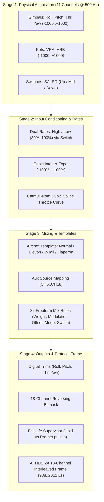

# FLIGHT CONTROL & 18-CHANNEL MIXING ARCHITECTURE

Comprehensive reference for input conditioning (Dual Rates & Exponential), auxiliary channel assignment, built-in wing and tail templates, and the EdgeTX/OpenTX-inspired 18-channel freeform matrix mixer on the FlySky FS-i6X.

---

## 1. Overview & Control Pipeline

The mixing system in `flysky-i6x-rs` implements an interrupt-safe, deterministic, zero-heap 4-stage pipeline that runs every main execution cycle (~500 Hz):



---

## 2. Input Conditioning: Dual Rates & Cubic Exponential

Before raw gimbal movements reach the mixer matrix, primary flight controls (Aileron, Elevator, Rudder) are conditioned with user-configurable **Dual Rates (D/R)** and **Exponential Curves (EXPO)**.

### Mathematical Formulation (Integer Arithmetic)
To ensure deterministic execution without floating-point emulation overhead on the Cortex-M0 core, exponential curves are computed using an exact integer cubic polynomial.

Given a normalized stick input `x` in the range `[-1000, +1000]` and active rate percentage `R` in `[30, 100]%`:

```text
x_scaled = (x * R) / 100
```

Let the normalized cubic component be:

```text
x_cubic = (x_scaled^3) / 1,000,000   (in range [-1000, +1000])
```

1. **Positive Expo (Expo > 0): Softens Center Sensitivity**
   Decreases stick sensitivity around the neutral stick position for smooth scale flying, while retaining 100% mechanical throw at gimbal endpoints:
   ```text
   Output = (x_scaled * (100 - Expo) + x_cubic * Expo) / 100
   ```

2. **Negative Expo (Expo < 0): Heightens Center Sensitivity**
   Increases stick sensitivity near center for aggressive 3D aerobatic maneuvers:
   ```text
   Output = x_scaled + ((x_scaled - x_cubic) * |Expo|) / 100
   ```

Implemented in [`src/mixer.rs`](../src/mixer.rs#L44-L64).

### D/R Switch Assignment
In the **Dual Rate / Expo** menu, the pilot selects an assigned hardware switch:
- `None`: High rate always active.
- `SA`: 2-position switch (UP = High Rate, DOWN = Low Rate).
- `SB`: 3-position switch (UP = High Rate, MID/DOWN = Low Rate).
- `SC`: 3-position switch (UP = High Rate, MID/DOWN = Low Rate).
- `SD`: 2-position switch (UP = High Rate, DOWN = Low Rate).
- `SE`: 2-position switch (UP = High Rate, DOWN = Low Rate, active-LOW mod).
- `SF`: 2-position switch (UP = High Rate, DOWN = Low Rate, active-LOW mod).

Independent High and Low rates (30%..100%) and Expo (-100%..+100%) can be configured per channel (Roll, Pitch, and Yaw).

---

## 3. Wing & Tail Aircraft Templates

For standard aircraft configurations, the firmware provides pre-configured wing and tail templates that automatically route and mix the conditioned stick inputs into the output matrix:

### 1. Normal (Standard 4-Channel)
- **CH1**: Roll / Aileron (Right Gimbal Horizontal)
- **CH2**: Pitch / Elevator (Right Gimbal Vertical)
- **CH3**: Throttle (Left Gimbal Vertical with Catmull-Rom spline curve)
- **CH4**: Yaw / Rudder (Left Gimbal Horizontal)

### 2. Elevon / Delta Wing (Flying Wings & Pusher Jets)
Combines Elevator and Aileron into two elevon surfaces on the trailing edge of the wing:
```text
CH1 (Left Elevon)  = (Pitch - Roll) / 2
CH2 (Right Elevon) = (Pitch + Roll) / 2
```
- When pulling back on the pitch stick (Up Elevator), both surfaces raise together.
- When deflecting the roll stick right, the right elevon raises and left elevon lowers.

### 3. V-Tail (V-Tail Gliders & Scale Planes)
Combines Elevator and Rudder into two angled tail surfaces:
```text
CH2 (Left V-Tail)  = (Pitch + Yaw) / 2
CH4 (Right V-Tail) = (Pitch - Yaw) / 2
```
- **CH1**: Standard Aileron control.
- When pulling back on pitch, both V-tail surfaces deflect upward.
- When yawing right, the left surface moves up and right surface moves down.

### 4. Flaperon (Dual Ailerons with Integrated Flaps)
Controls two independent wing servos for full-span ailerons and camber/flap control:
```text
CH1 (Left Aileron)  = Roll + (Flap / 2)
CH6 (Right Aileron) = -Roll + (Flap / 2)
```
- Flap deployment is driven by the physical source assigned to **CH6** in the `Aux Channels` menu (e.g. switch `SB` for 3-position flaps, or rotary knob `VRA` for variable camber).

---

## 4. Auxiliary Channel Remapping (CH5..CH18)

All 14 auxiliary channels (CH5 through CH18) can be independently assigned to any physical control on the radio from the `Aux Channels` menu:

| Source ID | Label | Description | Output Range |
| :--- | :--- | :--- | :--- |
| **0** | `None` | Neutral output (no input source) | 1500 µs |
| **1** | `Roll` | Conditioned Aileron stick input | 988..2012 µs |
| **2** | `Pitch`| Conditioned Elevator stick input | 988..2012 µs |
| **3** | `Thr`  | Spline-curved Throttle stick input | 988..2012 µs |
| **4** | `Yaw`  | Conditioned Rudder stick input | 988..2012 µs |
| **5** | `VRA`  | Left rotary dial potentiometer | 988..2012 µs |
| **6** | `VRB`  | Right rotary dial potentiometer | 988..2012 µs |
| **7..10** | `SA..SD` | Physical switches `SA`..`SD` (2-pos, 3-pos, 6-pos, or pot per `AdcInputMode`) | 988..2012 µs |
| **31..32**| `SE..SF` | Rear tactile buttons `PA9`/`PA10` (when configured as `RC SW`) | UP: 988 µs / DN: 2012 µs |
| **33..34**| `SG..SH` | Header `J4` tactile buttons `PA13`/`PA14` (when `J4 Mode` = `SG/SH BTN`) | UP: 988 µs / DN: 2012 µs |
| **37..41**| `VRC..VRG`| Extended analog pots on `PC1..PC5` (when `Ext ADC (PC)` enabled) | 988..2012 µs |
| **42..44**| `SWK..SWM`| Extended switches on `PC3..PC5` (when configured in switch mode) | 988 / 1500 / 2012 µs |

### Factory Default Auxiliary Mapping
- `CH5`: **SA** (Arming switch / Flight mode)
- `CH6`: **SB** (3-position flight modes: Angle / Horizon / Acro)
- `CH7`: **VRA** (Gimbal tilt / Camber flap)
- `CH8`: **VRB** (Payload release / Volume)
- `CH9`: **SC** (3-position auxiliary: Beeper / OSD switch)
- `CH10`: **SD** (Throttle cut / Rescue switch)
- `CH11..CH18`: `None` (Centered 1500 µs)

---

## 5. Freeform Matrix Mixer Engine

For custom aircraft geometries, complex sailplanes, multi-engine craft, and safety interlocks, every model profile includes **32 freeform mix lines** (`M01` through `M32`).

### Mix Rule Parameters
Each mix line comprises a compact 8-byte struct stored in non-volatile memory:

```rust
#[repr(C)]
#[derive(Copy, Clone, Debug, PartialEq, Eq)]
pub struct MixLine {
    pub target_ch: u8,   // 0: Disabled, 1..18: Target Channel (CH1..CH18)
    pub source: u8,      // 0: None, 1..4: AETR, 5..6: VRA/VRB, 7..10: SA..SD, 11: MAX, 12..29: CH1..CH18, 30: Thr+, 31..40: SE..VRF
    pub weight_src: u8,  // 0: Fixed Weight, 1..18: Modulate with CH1..CH18 (Bipolar -100%..+100%), 19..36: Modulate (Unipolar 0..100%)
    pub weight: i8,      // -100% .. +100% (gain / authority)
    pub offset: i8,      // -100% .. +100% (center shift)
    pub switch: u8,      // 0: Always ON, 1..22: Switch condition (SA^..SWJv)
    pub mode: u8,        // 0: ADD (+), 1: MULTIPLY (*), 2: REPLACE (:=)
    pub _reserved: u8,   // 1-byte padding for 8-byte alignment
}
```

### Dynamic Weight Modulation
Mix lines can dynamically scale their gain authority based on real-time channel inputs or knobs:
- **`Fixed` (`weight_src = 0`)**: The configured `weight` setting is applied directly.
- **`CH1`..`CH18` (`weight_src = 1..18`)**: Bipolar modulation. The effective weight is multiplied by the modulating channel value (-1000..+1000 -> -100%..+100%). Useful for variable dual rates or knob-controlled mixer gains.
- **`CH1+`..`CH18+` (`weight_src = 19..36`)**: Unipolar modulation (0..+1000 -> 0%..+100%). Ideal for flap-to-elevator compensation scaled by a knob, or spoilerons active only in one stick half.

The effective term added to the channel is:
```text
Effective_Weight = match weight_src {
    0 => weight,
    1..=18 => (weight * Channel[weight_src - 1]) / 1000,
    19..=36 => (weight * max(0, (Channel[weight_src - 19] + 1000) / 2)) / 1000,
};
Term = (Source * Effective_Weight) / 100 + (Offset * 10);
```

### Multiplex Modes
When a mix line is active, it modifies the target channel based on its configured mode:
1. **`ADD (+)`**: Adds the weighted source to the current channel value:
   ```text
   Channel_new = Channel_current + Term
   ```
2. **`MULTIPLY (*)`**: Scales the current channel value by the source (e.g. gain knobs, variable differential):
   ```text
   Channel_new = (Channel_current * Term) / 1000
   ```
3. **`REPLACE (:=)`**: Overrides and replaces the target channel completely (e.g. throttle cut, emergency level/rescue switch):
   ```text
   Channel_new = Term
   ```

### Switch Conditions & Dynamic Hardware Filtering
A mix line can be gated by any hardware switch condition (0..22):
- `ON`: Always active.
- `SA^`, `SAv`: Active when switch `SA` is UP or DOWN.
- `SB^`, `SB-`, `SBv`: Active when switch `SB` is UP, MID, or DOWN.
- `SC^`, `SC-`, `SCv`: Active when switch `SC` is UP, MID, or DOWN.
- `SD^`, `SDv`: Active when switch `SD` is UP or DOWN.
- `SE^`..`SWMv`: Active on secondary/expansion switches.

### Dynamic Filtering of Sources and Switches
The mixer UI dynamically queries the active hardware configuration (`RadioConfig`) and channel assignments (`ModelConfig`) to filter selection lists:
- **Switches & Switch Conditions**: Only physical switches enabled in hardware are selectable. For example, `SE`/`SF` conditions only appear if `ext_switches` is enabled; `SG`/`SH` conditions only appear if `j4_sg_sh_en` is set; `SWI`..`SWM` conditions only appear if `ext_adc` is enabled and those auxiliary channels are configured in switch mode.
- **Pots & Sliders**: `VRA` and `VRB` only appear if their respective ADC channels are configured as potentiometers. `VRC`..`VRG` only appear when `ext_adc` is enabled with analog potentiometer mode.
- **Channels**: Auxiliary channels `CH5`..`CH18` only appear in Source and Weight Modulation (`Wt Src`) selector lists if they are actively configured (mapped to an auxiliary input, driven by a wing template, or targeted by an active mixer rule). Unconfigured/unassigned channels are automatically skipped.

---

## 6. Practical EdgeTX / OpenTX Mixer Recipes

Here are proven mixer setups used by RC pilots:

### Recipe 1: Throttle Cut Safety Switch
*Prevents accidental motor start by locking CH3 to minimum pulse (1000 µs) whenever switch `SD` is flipped DOWN:*
- **Target**: `CH3`
- **Source**: `MAX`
- **Weight Src**: `Fixed`
- **Weight**: `-100%`
- **Offset**: `0%`
- **Switch**: `SDv`
- **Mode**: `REPLACE (:=)`

### Recipe 2: Throttle-to-Elevator Pitch Compensation (Unipolar `Thr+`)
*High-thrust airplanes often balloon upward when applying full throttle. This mix automatically injects a small amount of down-elevator as throttle increases without introducing negative elevator deflection at idle:*
- **Target**: `CH2` (Elevator)
- **Source**: `Thr+` (Unipolar half-range throttle: 0 at idle, linearly ramping to +1000 at full throttle)
- **Weight Src**: `Fixed`
- **Weight**: `-10%`
- **Offset**: `0%`
- **Switch**: `ON`
- **Mode**: `ADD (+)`

### Recipe 3: Knob-Modulated Flap-to-Elevator Trim
*Automatically trims elevator when flaps deploy, with master trim authority scaled by potentiometer `VRA`:*
- **Target**: `CH2` (Elevator)
- **Source**: `CH6` (Flaps)
- **Weight Src**: `CH7` (VRA assigned to CH7, bipolar scale)
- **Weight**: `-25%` (Max down elevator authority)
- **Offset**: `0%`
- **Switch**: `ON`
- **Mode**: `ADD (+)`

### Recipe 4: Twin-Engine Differential Thrust
*Twin-motor planes or boats can spin tightly using motor thrust mixed with rudder:*
- **CH3 (Left Motor)**: Driven by normal throttle.
- **CH5 (Right Motor)**: In `Aux Channels`, set source to `Thr`.
- **Mix 1 (Left Motor Yaw Mix)**:
  - Target: `CH3`, Source: `Yaw`, Weight Src: `Fixed`, Weight: `+20%`, Mode: `ADD (+)`
- **Mix 2 (Right Motor Yaw Mix)**:
  - Target: `CH5`, Source: `Yaw`, Weight Src: `Fixed`, Weight: `-20%`, Mode: `ADD (+)`

### Recipe 5: Crow / Butterfly Sailplane Airbrakes
*For high-performance gliders: deploys flaps full down, raises both ailerons up, and feeds in down-elevator compensation to dive without gaining speed:*
- **Template**: `Flaperon` (CH1 Left Aileron, CH6 Right Aileron).
- **Mix 1 (Flap-to-Aileron Crow)**:
  - Target: `CH1`, Source: `VRA`, Weight Src: `Fixed`, Weight: `+40%`, Mode: `ADD (+)`
- **Mix 2 (Elevator Compensation)**:
  - Target: `CH2`, Source: `VRA`, Weight Src: `Fixed`, Weight: `-15%`, Mode: `ADD (+)`

---

## 7. Model Profile Storage Layout

Flight mixer parameters are stored directly inside each 348-byte [`ModelConfig`](../src/storage.rs) structure in the on-chip Flash non-volatile log (`sequential-storage` on Pages 60..63 at `0x0801_E000`..`0x0802_0000`):

| Parameter | Type | Bytes | Description |
| :--- | :--- | :--- | :--- |
| `name` | `[u8; 10]` | 10 | 10-char ASCII model name |
| `dr_switch` | `u8` | 1 | Dual Rate switch selector (0..6) |
| `thr_curve_pts` | `u8` | 1 | 5, 7, or 9 point curve mode |
| `thr_curve_smooth` | `u8` | 1 | 0: Linear, 1: Catmull-Rom spline |
| `thr_curve` | `[u8; 17]` | 17 | Throttle curve points (0..100%, reserved up to 17) |
| `dr_high` | `[u8; 3]` | 3 | High rates: AIL, ELE, RUD (50..100%) |
| `dr_low` | `[u8; 3]` | 3 | Low rates: AIL, ELE, RUD (30..100%) |
| `expo_high` | `[i8; 3]` | 3 | High expo: AIL, ELE, RUD (-100..+100%) |
| `expo_low` | `[i8; 3]` | 3 | Low expo: AIL, ELE, RUD (-100..+100%) |
| `aux_channels` | `[u8; 14]` | 14 | Source mappings for CH5..CH18 |
| `wing_tail_mix` | `u8` | 1 | Aircraft template (0..3) |
| `template_diff` | `i8` | 1 | Template differential (-100..+100%) |
| `mixes` | `[MixLine; 32]` | 256 | 32 freeform matrix mix rules (32 * 8 bytes) |

Total `ModelConfig` size: **exactly 348 bytes**.

> [!NOTE]
> In SRAM, an **Active-Model Cache** architecture is employed: `RadioStorage` holds only `RadioConfig` (148 B) and the single active `ModelConfig` (348 B), occupying only 496 bytes total. This leaves over **9.4 KB (>58%) of SRAM** free for stack operations on the STM32F072.
